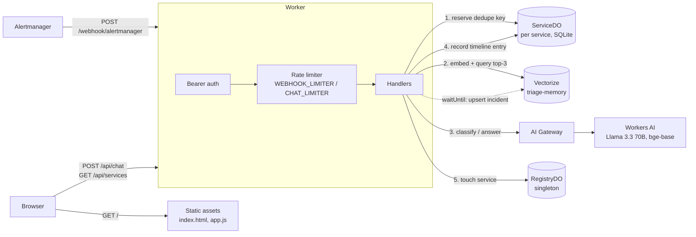

# cf_ai_triage_copilot

An AI on-call copilot for Prometheus Alertmanager, built on Cloudflare Workers.

Live demo: https://cf-ai-triage-copilot.cf-ai-triage-copilot.workers.dev

Alertmanager sends webhooks to a Worker. **Llama 3.3 on Workers AI** (called through **AI Gateway**) triages each alert: severity, user impact, likely cause and a concrete first step. One **Durable Object per service** handles dedupe and keeps a rolling incident timeline. **Vectorize** stores runbooks and past incidents, and the top matches are given to the model as context. A small chat page (served as **static assets**) lets you ask things like *"what's happening with checkout?"* and get answers grounded in the live timelines.

**Why:** at 3 a.m. alerts come in bursts with raw labels and no context. This project turns each alert into a short triage card, drops repeats, links related runbooks and past incidents, and gives you one place to ask what's going on.

> The AI prompts used while building this project are in [`prompts.txt`](./prompts.txt).

## Features

- **Alertmanager webhook** (`POST /webhook/alertmanager`) with bearer auth (`WEBHOOK_TOKEN`, required in production) and per-sender rate limiting.
- **LLM triage** with Llama 3.3 70B (`@cf/meta/llama-3.3-70b-instruct-fp8-fast`) using JSON-schema structured output, through AI Gateway so repeat prompts come from the cache.
- **Retrieval-augmented context**: alerts are embedded with `@cf/baai/bge-base-en-v1.5` and matched against runbooks and past incidents in Vectorize. Each classified alert is written back as a new "past incident".
- **Per-service Durable Objects** (SQLite) for atomic dedupe and a rolling 200-entry timeline. A singleton registry DO lists every service.
- **Resolved alerts** inherit the triage of the alert that fired, with severity set to `info`. No LLM call is made.
- **Chat copilot** (`POST /api/chat`) works out which services you mean, pulls their timelines and relevant runbooks, and answers using only that context.
- **Degrades gracefully**: timeouts, retries with backoff, and a rule-based fallback classifier, so you always get an answer even when the AI is down.
- **Web UI**: chat, a service list coloured by severity, and per-service timelines. Plain JavaScript, works on mobile.

## Architecture



### Webhook flow

1. Auth: if `WEBHOOK_TOKEN` is set, the bearer must match (constant-time), else 401. If it is unset the webhook fails closed with 503, unless `ENVIRONMENT=development` (local only), where auth is skipped and a warning is logged.
2. `WEBHOOK_LIMITER.limit({ key })`. The key is a hash of the bearer token, or the client IP. Over the limit returns 429 with `Retry-After: 60`.
3. Parse and validate the payload, keeping at most 100 alerts. Bad input returns 400.
4. Each alert is processed with at most 4 in flight:
   - Get the service from labels (`service` → `app` → `app.kubernetes.io/name` → `job` → `commonLabels.service` → `namespace`) and the fingerprint (Alertmanager's own, or an FNV-1a hash of the labels).
   - `ServiceDO.reserve("<fp>:<status>")` runs synchronously. A repeat within the window is reported as a **duplicate** and nothing else happens.
   - **Resolved** alerts inherit the previous triage with severity `info`. No LLM call.
   - **Firing** alerts: embed the alert text, query Vectorize for the top 3 matches, then classify with the LLM. Only the first `MAX_LLM_PER_REQUEST` alerts in a request use the LLM; the rest use the rule-based fallback. The alert is then upserted as an incident in the background.
   - `ServiceDO.record(entry)`, then `RegistryDO.touch(service)`.
5. Responds `200 {received, dropped, results[]}`. If any alert hit an internal error, the response is `500` (same body) so Alertmanager retries. Alerts that already succeeded come back as duplicates on the retry.

### Chat flow

1. `CHAT_LIMITER` is keyed by IP (20 requests/min). The message must be 1–1000 characters.
2. `RegistryDO.list()` and `detectServices(message)` pick up to 3 targets. Exact names win over the first segment of a name (`checkout` → `checkout-api`). If nothing matches, the 3 most recently active services are used.
3. In parallel: fetch the last 20 timeline entries for each target, and embed the message to get the top 3 runbook matches.
4. Llama 3.3 answers from that context only (gateway cache skipped). If the LLM fails, you get a templated digest of the timelines instead.
5. Responds `{answer, services, sources:[{id,title,score}], source: "llm"|"fallback"}`.

## Reliability

| Concern | Mechanism |
| --- | --- |
| Slow model | `withTimeout` on every AI call (`LLM_TIMEOUT_MS`, default 12s) |
| Flaky model / bad JSON | `withRetry`: 2 retries, exponential backoff (300ms, 600ms) + jitter. Invalid or unparseable JSON counts as a failure and is retried |
| Model down | `fallbackClassify`: maps label severity and synonyms (`page`, `p1`, `sev2`, `warning`, …) or keywords (`down`, `5xx`, `latency`, …), confidence 0.3, links `runbook_url` if present. Chat falls back to a timeline digest |
| Retrieval down | `embed`/`querySimilar`/`upsertIncident` catch every error and return empty results. Classification still runs, just without context |
| Duplicate notifications | `ServiceDO.reserve` is atomic (synchronous SQL in a single-threaded object). The key is `fingerprint:status` with a `DEDUPE_WINDOW_SECONDS` (1h) sliding window. A resolve clears the firing key, so a re-fire is processed again |
| Webhook auth | Fails closed: no `WEBHOOK_TOKEN` means 503 `webhook auth not configured`, not an open endpoint. `ENVIRONMENT` is `production` in `wrangler.jsonc`; only `ENVIRONMENT=development` in `.dev.vars` skips auth |
| Floods | Workers Rate Limiting binding: webhook 60/min per token or IP, chat 20/min per IP. At most 10 LLM calls per webhook request, the rest use the fallback |
| Cost / latency | AI Gateway caching (`cacheTtl: 3600`) for classification. Prompts exclude timestamps and per-pod labels so repeats hit the cache |
| Validation | Structured output (`response_format: json_schema`) plus strict validation: severity synonyms, confidence scaled from percentages and clamped to 0..1, text fields trimmed and capped at 500 chars |

## API reference

All responses are JSON. Examples assume `BASE=http://localhost:8787`.

### `POST /webhook/alertmanager`

Takes the standard Alertmanager webhook payload (v4). Send `Authorization: Bearer $WEBHOOK_TOKEN`. Returns 401 for a missing or wrong token, and 503 if `WEBHOOK_TOKEN` isn't configured (except with `ENVIRONMENT=development` locally).

```bash
curl -X POST $BASE/webhook/alertmanager \
  -H "Authorization: Bearer $WEBHOOK_TOKEN" \
  -H "Content-Type: application/json" \
  --data-binary @scripts/sample-alerts/checkout-down.json
```

```json
{
  "received": 1, "dropped": 0,
  "results": [{
    "service": "checkout-api", "fingerprint": "c0ffee0000000001", "status": "firing",
    "outcome": "classified", "severity": "critical", "source": "llm",
    "user_impact": "Customers cannot complete checkout; ~38% of requests fail.",
    "suggested_action": "Roll back deploy 2026.45.1 for checkout-api."
  }]
}
```

`outcome` is `classified`, `duplicate` (includes `hits`), `resolved` or `error`. `source` is `llm`, `fallback` or `inherited`.

Alertmanager receiver config:

```yaml
receivers:
  - name: triage-copilot
    webhook_configs:
      - url: https://cf-ai-triage-copilot.cf-ai-triage-copilot.workers.dev/webhook/alertmanager
        http_config:
          authorization:
            credentials: <WEBHOOK_TOKEN>
```

### `POST /api/chat`

```bash
curl -X POST $BASE/api/chat -H "Content-Type: application/json" \
  -d '{"message":"what is happening with checkout?"}'
```

```json
{ "answer": "checkout-api: critical 5xx spike since 14:02 UTC…", "services": ["checkout-api"],
  "sources": [{ "id": "rb:high-5xx-rate", "title": "Runbook: elevated HTTP 5xx error rate", "score": 0.82 }],
  "source": "llm" }
```

### `GET /api/services`

```bash
curl $BASE/api/services
# {"services":[{"name":"checkout-api","first_seen":…,"last_seen":…,"last_severity":"critical","alert_count":3}]}
```

### `GET /api/services/:name/timeline?limit=50`

Newest first, max 200. Returns 404 for services that have never sent an alert.

```bash
curl "$BASE/api/services/checkout-api/timeline?limit=10"
```

### `POST /admin/seed`

Loads the 13 bundled runbooks and past incidents (`src/seed-data.ts`) into Vectorize. Safe to run again, since the ids are stable. Requires `ADMIN_TOKEN`: returns 503 if it isn't set, 401 if the token is wrong.

```bash
curl -X POST $BASE/admin/seed -H "Authorization: Bearer $ADMIN_TOKEN"
# {"seeded":13,"total":13}
```

## Running locally

Requires Node 20+ (CI uses 24) and a Cloudflare account. Workers AI and Vectorize have no local emulator, so `npm run dev` uses **remote bindings** (`"remote": true` in `wrangler.jsonc`) for those two. Everything else (Durable Objects, rate limiter, assets) runs locally.

```bash
npm install
npx wrangler login
npx wrangler vectorize create triage-memory --dimensions=768 --metric=cosine
cp .dev.vars.example .dev.vars       # then edit the tokens (ENVIRONMENT=development: empty WEBHOOK_TOKEN skips auth locally)
npm run dev                          # http://localhost:8787

# in another shell
export WEBHOOK_TOKEN=change-me ADMIN_TOKEN=change-me
curl -X POST http://localhost:8787/admin/seed -H "Authorization: Bearer $ADMIN_TOKEN"
cd scripts
./send-alert.sh http://localhost:8787 sample-alerts/checkout-down.json      # classified
./send-alert.sh http://localhost:8787 sample-alerts/duplicate.json          # duplicate
./send-alert.sh http://localhost:8787 sample-alerts/payments-latency.json   # 2 alerts
./send-alert.sh http://localhost:8787 sample-alerts/checkout-resolved.json  # resolved (inherited)
```

Then open http://localhost:8787 and ask "what's happening with checkout?".

AI Gateway: `AI_GATEWAY_ID` is `"default"`, which Cloudflare creates automatically on first use, so there's no dashboard setup.

### Fully offline mode (`npm run dev:local`)

`wrangler dev --local` runs without any remote bindings. AI and Vectorize calls fail straight away, which is a quick way to see the **fallback path**: webhooks still get classified (`"source": "fallback"`, confidence 0.3), dedupe and timelines work normally, and chat returns the templated timeline digest. Seeding returns 502.

## Deploying

```bash
npx wrangler vectorize create triage-memory --dimensions=768 --metric=cosine   # once
npx wrangler secret put ADMIN_TOKEN
npx wrangler secret put WEBHOOK_TOKEN      # required; without it the webhook returns 503
npm run deploy
curl -X POST https://cf-ai-triage-copilot.cf-ai-triage-copilot.workers.dev/admin/seed -H "Authorization: Bearer $ADMIN_TOKEN"
```

## GitHub Actions

`.github/workflows/ci.yml` runs on every push and pull request: `npm ci`, a `wrangler types --check` drift check, `tsc --noEmit` and `vitest run`. Pushes to `main` then deploy with `cloudflare/wrangler-action@v3`.

Repository secrets:

- `CLOUDFLARE_ACCOUNT_ID`
- `CLOUDFLARE_API_TOKEN`: a custom API token with **Account › Workers Scripts: Edit**, **Workers AI: Read**, **Vectorize: Edit**, **AI Gateway: Edit** and **Account Settings: Read**.

The Vectorize index and the Worker secrets must already exist (see Deploying); CI doesn't create them.

## Tests

```bash
npm test          # vitest, plain Node, no workerd needed
npm run typecheck
```

Business logic lives in pure modules that never import `cloudflare:workers`: routing, auth, payload parsing, fingerprinting, fallback rules, LLM output parsing, prompts, retry/timeout and service detection. Each has its own test file in `test/`. Run `npm run types` after changing `wrangler.jsonc` and commit the regenerated `worker-configuration.d.ts` (run it without a `.dev.vars` file so secrets aren't included and CI's drift check passes).

## Project layout

```
src/
  index.ts            fetch entry: route → handler, otherwise static assets; exports the DO classes
  router.ts           PURE route matching
  http.ts             PURE json/error helpers, constant-time bearer check, rate-limit key
  alerts.ts           PURE payload validation, service extraction, fingerprint, dedupe key
  fallback.ts         PURE rule-based classifier
  llm-parse.ts        PURE JSON extraction + triage validation
  prompts.ts          PURE message builders, JSON schema, fallback digest
  resilience.ts       PURE withTimeout, withRetry, mapLimit
  chat-detect.ts      PURE service detection for chat
  llm.ts              Workers AI calls via AI Gateway (classify, chat)
  memory.ts           embeddings + Vectorize query/upsert/seed
  seed-data.ts        13 runbooks / past incidents
  handlers/           webhook, chat, services, admin
  do/                 ServiceDO (dedupe + timeline), RegistryDO (service list)
  types.ts            shared types
public/               index.html, app.js (UI)
scripts/              send-alert.sh, sample-alerts/*.json
test/                 vitest suites for the pure modules
```

## Design decisions

- **Plain `DurableObject` + SQLite instead of the Agents SDK.** The objects only need atomic state and RPC: no WebSockets, scheduling or chat history. A plain SQLite-backed DO means fewer dependencies and less to explain, and its methods are ordinary typed RPC calls.
- **Singleton RegistryDO instead of KV.** The service list is tiny and written on every alert. A DO gives consistent reads straight after a write, which KV doesn't, and there's nothing extra to provision.
- **Dedupe in the DO, LLM call in the Worker.** `reserve` is synchronous SQL with no `await`, so it's atomic without holding the object while a slow model call runs. Other alerts for the same service are never blocked behind the LLM.
- **Synchronous webhook.** Alertmanager retries on non-2xx, so doing the work inside the request (with bounded concurrency and an LLM budget) gives clear delivery behaviour without needing a queue. Answering only after the timeline is written also makes the system easy to reason about.
- **Prompts are built to hit the cache.** Classification prompts leave out timestamps and per-instance labels, so a repeated alert produces the same prompt and AI Gateway can serve it from cache. Chat sets `skipCache`.

## Limitations

- **Gap between reserve and record.** If the Worker crashes after `reserve` but before `record`, the alert is marked as seen but has no timeline entry, and retries within the dedupe window are dropped as duplicates.
- **Rate limits are per Cloudflare location** and approximate (that's how the Rate Limiting binding works), not a strict global quota.
- **`Promise.race` timeouts don't cancel** the underlying AI request. It keeps running, and is billed, until it finishes.
- **One shared Vectorize index** for runbooks and incidents with no per-tenant namespace. Each incident vector is keyed by fingerprint, so repeats overwrite each other rather than piling up.
- **Timelines keep the last 200 entries** per service, and the chat sees the latest 20 per service (up to 3 services).
- **No auth on the UI or chat API**: they're protected only by rate limiting. Put Cloudflare Access in front for real use.
